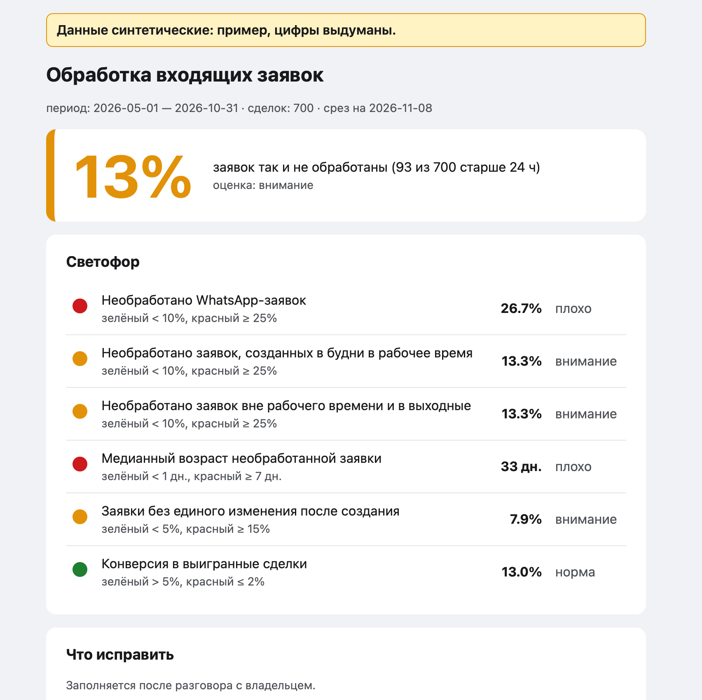

# Bitrix24 lead-handling analysis

**English** | [Русский](README.ru.md)

An analytics project that finds where incoming leads get lost in the CRM
of a trading company. The real data is not published: the repository holds
only the code and a synthetic sample with the same structure.

## The problem

The company's conversion of incoming leads was falling. There were plenty of
hypotheses ("the channel is bad", "the managers are slow"), but they rested on
impressions, not data. The task was to take a deal export from Bitrix24 and
answer: where exactly are leads lost, and is the cause the channel, the people
or the process?

## Data

A `crm.deal.list` export from the Bitrix24 REST API: **about 17,600 deals**
over three years. Fields: source, stage, creation and modification dates,
assignee, amount. The repository contains no personal data, company names or
amounts; see "Data and privacy" below.

## Findings (anonymised)

- About **a quarter of all leads** were stuck at the "New" stage and never
  handled; the median age of such a lead was over six months.
- Three quarters of the stuck leads came from the **WhatsApp channel**.
- A month-by-month breakdown showed that in the early months the same channel
  was handled almost completely (a few percent unhandled), and then for
  several months in a row **more than 85% of requests** stayed unhandled.
  Conclusion: the problem is not the channel but a process that broke down as
  volume grew.
- The deal amount is filled in for fewer than 1% of rows, so losses in money
  can only be given as an order of magnitude, with caveats.

A separate part of the work is honest metrics. The analyzer **does not
measure** first response time: a deal export has only the date of the last
change (`DATE_MODIFY`), not of the first touch. So the report speaks of the
"age of an unhandled lead" and "leads with no changes after creation", not of
response speed. The reference point is the latest date in the data, not
`now()`; leads younger than 24 hours are not counted as stuck; the median is
used instead of the mean because of the long tail; pipelines are not mixed.

## How to run

```bash
pip install -r requirements.txt
python generate_sample.py   # creates sample_data.csv (already in the repo)
python analyze.py           # analyses sample_data.csv
```

The result is a console report and a `report.html` page: one headline number,
a traffic light of indicators and an empty "What to fix" block. The report
text is in Russian, as it was written for a Russian-speaking client.

Tests:

```bash
python -m pytest tests/ -v
```

Your own data, either a CSV exported from the Bitrix24 interface (Russian
column names) or an xlsx exported through the API:

```bash
python analyze.py path/to/deals.csv
```

Stage names, sources, working hours and traffic-light thresholds are set in
`src/config.py`.

Exporting directly from Bitrix24 (the token lives only in the environment,
see `.env.example`):

```bash
export BITRIX_WEBHOOK="https://<portal>.bitrix24.<tld>/rest/<user_id>/<token>/"
python analyze.py --fetch
```

**The data below is synthetic.** The example is built from `sample_data.csv`:
700 made-up deals over 6 months; manager names and amounts are fictional.



## Structure

```
analyze.py           # entry point: load → prepare → reports
generate_sample.py   # synthetic dataset generator
sample_data.csv      # synthetic sample (700 rows, made-up values)
src/
  config.py          # stages, channels, working hours, traffic-light thresholds
  fetch.py           # paginated export from the Bitrix24 REST API
  prepare.py         # csv/xlsx loading, anonymisation, derived fields
  reports.py         # console reports: stuck leads, by time, by manager,
                     # WhatsApp by month, loss estimate
  html_report.py     # the report.html page
tests/
  test_stages.py     # which stages count as new and as won
  test_light.py      # traffic-light colours by threshold
```

## Data and privacy

The real export and any csv/xlsx/json files are excluded by `.gitignore`
(the only exception is `sample_data.csv`). The API token lives only in the
`BITRIX_WEBHOOK` environment variable. The code and README contain no company
names, real people's names, contacts or amounts: the names and amounts in the
sample are made up.

On load, only the columns the analysis needs are kept: comments, contacts and
deal titles are dropped immediately. Assignee names are replaced with
"Менеджер N" ("Manager N"); the mapping is saved to `managers_map.csv` next to
the export. That file and `report.html` are also excluded by `.gitignore`.

## Stack

Python, pandas, numpy, pytest, Bitrix24 REST API (crm.deal.list), openpyxl, requests.

## License

[MIT](LICENSE)
